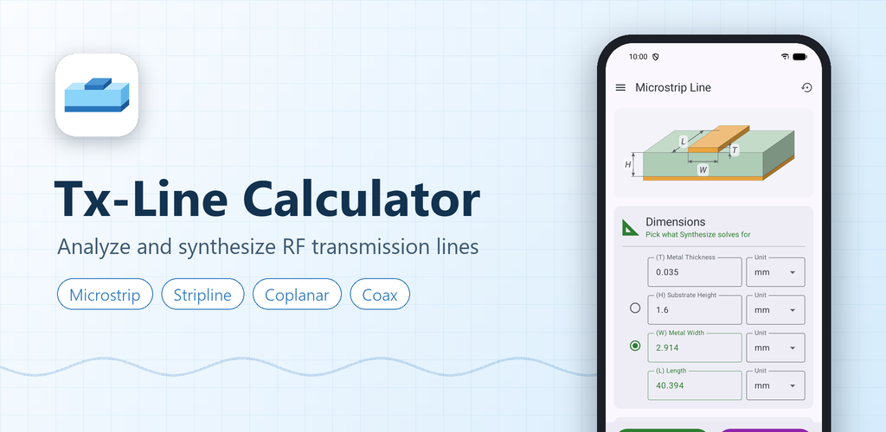
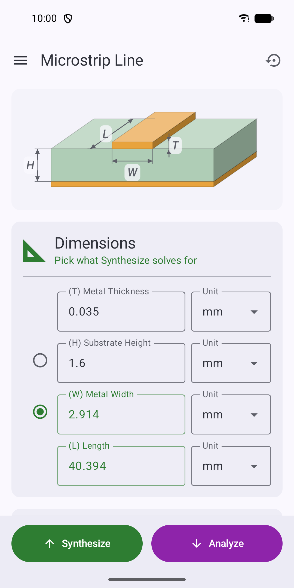
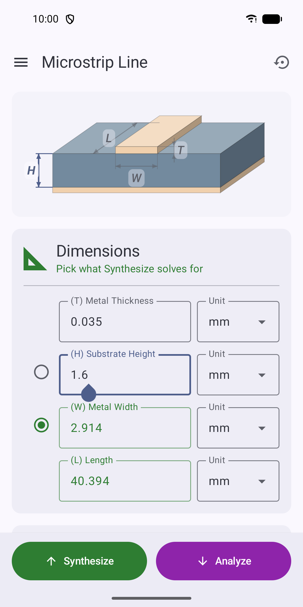
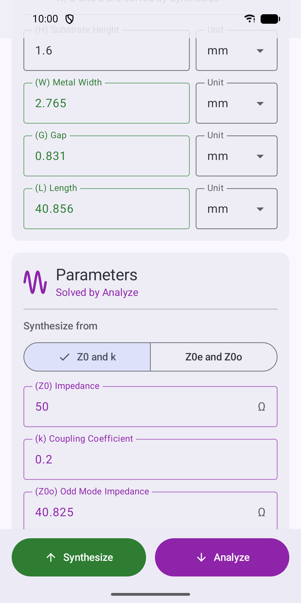
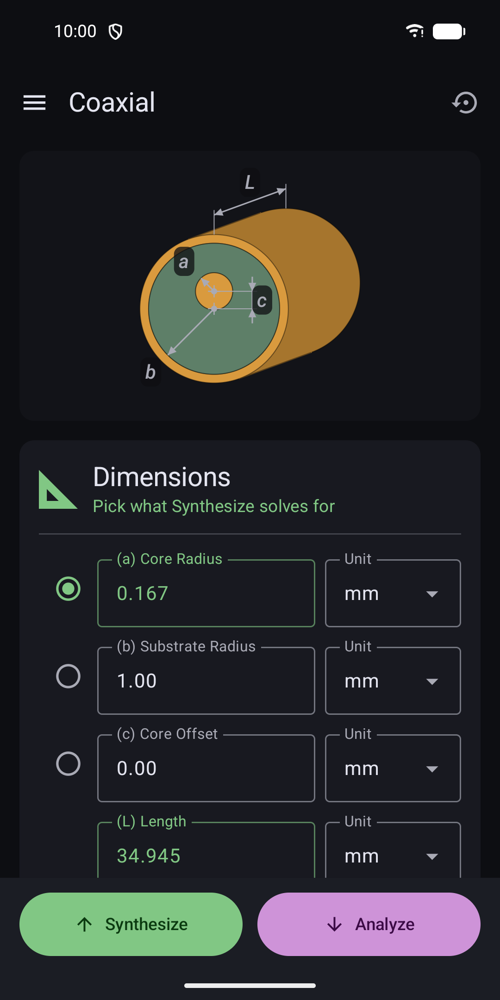
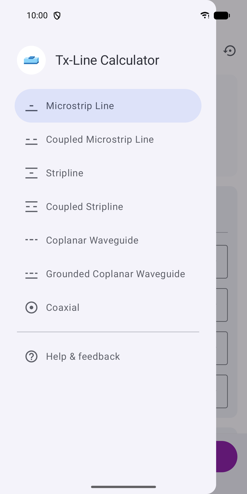

# Tx-Line Calculator

<a href="https://play.google.com/store/apps/details?id=com.rookiedev.microwavetools"></a>

A transmission line calculator for RF/microwave engineers.

## Background

This project started as a part-time hobby during my undergraduate studies. I was taking an RF/Microwave circuits course at the time, and Android was just emerging as a mobile platform. It was a natural exercise to combine what I was learning in class — transmission line theory and microwave circuit design — with the challenge of building an Android app from scratch.

The project has been kept alive and occasionally updated ever since.

## Features

- **Analyze** mode: calculate electrical parameters from physical dimensions
- **Synthesize** mode: calculate physical dimensions from electrical parameters, solving for the dimension you pick
- **Interactive diagrams**: editing a field highlights the matching part of the line; tap a label on the diagram to jump to its field
- **Units**: mil, mm or cm for dimensions; MHz or GHz for frequency
- **Coupled lines**: synthesize from Z0 and k, or from the even and odd mode impedances
- Values are saved between sessions; Material 3 design with dark mode and dynamic color

## Supported Transmission Lines

- Microstrip Line
- Coupled Microstrip Line
- Stripline
- Coupled Stripline
- Coplanar Waveguide
- Grounded Coplanar Waveguide
- Coaxial

## Screenshots







## Requirements

- Android 11 (API level 30) or higher
- Java 17 to build

## Building the Project

This project requires the Android SDK and Java 17. Build using the Gradle wrapper scripts provided:

```sh
./gradlew build
```

On Windows, use:

```sh
gradlew.bat build
```

Run the calculator tests with:

```sh
./gradlew :mobile:testDebugUnitTest
```

## Project Structure

- `mobile/src/main/java/.../libs/` — the transmission line models and calculators
- `mobile/src/main/java/.../ui/` — the Jetpack Compose UI: one shared calculator screen, line diagrams and theme
- `pics/play-store/` — Google Play feature graphic and phone screenshots

## License

This project is licensed under the GNU General Public License v3.0. See the [LICENSE](LICENSE) file for details.
